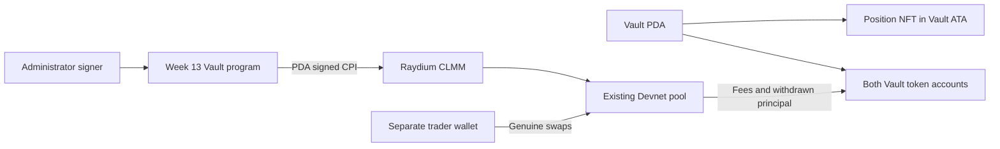

# Liquidity Vault - Week 13

**Settlement addendum:** The original results below belong to immutable commit `87d58a2` and program `8Fwjh2gQ9qAQFZ4jVPKPe8G6xEq2dQJatFDv4A6iw2Qa`. The [Post-CLMM Settlement and User Withdrawal](#post-clmm-settlement-and-user-withdrawal) section documents a separate deployment and a finalized user redemption. All original evidence and links are preserved.

**Verified on Solana Devnet:** Vault-controlled opening, fee collection, complete closure and out-of-range rebalancing. The independent verifier passed for **25 finalized transactions**, including deployment. All three test positions are now closed.

## Verify the submission in a few minutes

```bash
npm ci
npm run verify:week13
```

No wallet, private key, Anchor build or transaction submission is required for verification. The recorded run also passed with `ANCHOR_WALLET` pointing to a nonexistent file. Read [verification-summary.json](evidence/week13/verification-summary.json) and the transaction links below. Verification was executed at `2026-11-19T17:11:29.505Z` UTC; transaction slots identify historical execution independently of current pool state.

## Assignment and implementation

The [original methodology, page 7](evidence/week13/requirements-page-7.txt), requires administrator-selected bounds, both token contributions with maxima, a Vault-owned position NFT, fee collection, full withdrawal with minima, and a genuine out-of-range rebalance.

| Vault instruction | Official Raydium CPI sequence | Result |
|---|---|---|
| `open_position` | `open_position_v2` with zero liquidity, then `increase_liquidity_v2` | Admin pays rent; Vault supplies both tokens and owns the NFT |
| `collect_position_fees` | `decrease_liquidity_v2` with liquidity zero | Fees enter Vault token accounts; position liquidity remains unchanged |
| `close_position` | Full `decrease_liquidity_v2`, then `close_position` | Both outputs go to Vault, NFT is burned, NFT account and personal position close |

Opening and funding are atomic. The rent payer and token authority are separated because the Vault PDA is a program-owned state account. A failure in either opening CPI rolls back the whole instruction. Withdrawal and NFT closure are likewise one atomic Vault instruction.



Vault signer seeds are `["vault", token_mint, bump]`. The manager PDA uses `["position", vault_state]` and stores the bound pool, NFT mint, personal-position address, range, liquidity and active flag. Only one position may be active. NFT mint keypairs sign account creation; custody belongs to the NFT token account's **Vault PDA authority**.

## Devnet addresses

| Account | Address |
|---|---|
| Week 13 program | `8Fwjh2gQ9qAQFZ4jVPKPe8G6xEq2dQJatFDv4A6iw2Qa` |
| Vault PDA / NFT authority | `CsFJDQv7vdBvXvDzEoSqvZQccFZLbYqAJcTeaSjZUfKN` |
| TOKEN_A account | `6ywuuHXGwoXxsMoUufL9BpeLkKGXzohPvrXgxpaLDAyi` |
| TOKEN_B account | `DveZCv2hMWqZ5UbdBQxyp4xC6aZPpofpkN2xTzgghHuZ` |
| Share mint | `GDoh9tMjfVzrUYH7PQxF8KYtfVNkMqay6ELpB8b4e8ET` |
| Position manager PDA | `H4VjkQSzC6fV9NWbf4GyEnyZQ2iFK4hrcrkfbqHJv3Pv` |
| Administrator | `3jiQ6pVz6xZ4VqmDho41aPUgXFQns5KeorWyEgb3Qdq7` |
| Separate trader | `8YYWcK5FA79Y9L3PMmWaukgEKbHLq9NXFm4TG5Pn1cgJ` |
| Raydium CLMM | `DRayAUgENGQBKVaX8owNhgzkEDyoHTGVEGHVJT1E9pfH` |
| Pool | `EKwcP1HdZsti8ALXNvAUAduWfYLXH76DeJkcH39auM1f` |
| TOKEN_A / token_0 mint | `7bdCcN9agJ3TSSjTFctxM4TGFVecBRd6gLNYoWYyvawF` |
| TOKEN_B / token_1 mint | `CwHVUNisByLqXM7mN47nhtcfG8AkYxeJ3tBdFB66yZAt` |

Both mints are ordinary SPL tokens with **six decimals**. Full derived addresses are in [addresses.json](evidence/week13/addresses.json). Deployment used a new 604,864-byte program and exact-size allocation; [deployment receipt](https://explorer.solana.com/tx/31oM1gN5Wjzxqd3CaPKpftoLEfXq5xEsEEwPj7NDMrN3SD24W8Cyn9Ypz36vP58NtrepPuCPpMCTYee9uLKJmqZW?cluster=devnet). The verifier compares the deployed ELF against SHA-256 `e6712608e22f254b87a2c48f881ce0502cc6cde62a79bd507d6eae9dd112f666` and checks the loader deployment, slot and upgrade authority.

## Chosen ranges and opening amounts

Price is **TOKEN_B per TOKEN_A**. With equal decimals, a tick boundary is `1.0001^tick`, and execution price is `sqrt_price_x64^2 / 2^128`. Prices below are rounded to 12 decimal places; exact sqrt prices are preserved in the verification summary. Tick spacing is 60. The upper range boundary is exclusive.

| Position | Tick range | Price bounds | Actual opening price | Liquidity | A contributed | B contributed |
|---|---|---|---|---|---|---|
| Normal | `-720 .. 480` | 0.930534245505 .. 1.049168137486 | 0.989738741819 | `661942349` | 19.119261 | 20.000000 |
| Old rebalance | `-180 .. -60` | 0.982161916245 .. 0.994018262239 | 0.989689211777 | `5276455704` | 11.562049 | 20.000000 |
| Replacement | `-840 .. 360` | 0.919435117457 .. 1.036653980636 | 0.981611022806 | `627135103` | 17.033840 | 20.000000 |

Every opening capped contributions at **20.000000 A and 20.000000 B**. Normal and replacement ranges extend 600 ticks around an aligned center, approximately 6% on each side. The old rebalancing position uses a narrower 120-tick total range so a genuine crossing can be demonstrated with modest test-token swaps.

LP token composition changes with price because CLMM liquidity exchanges one asset for the other inside its range. Below the lower bound it holds token_0; above the upper bound it holds token_1. Rebalancing closes an inactive range and opens a new one around the changed price.

## Normal lifecycle and fees

Setup deposited **200.000000 A** with shares. A Vault-signed swap exchanged 100.000000 A for **98.981011 B**. The normal position then contributed the amounts above. The separate trader executed A-to-B, B-to-A and A-to-B swaps of one token each. All three swaps were finalized between opening and fee collection, and their signer, pool and exact token flows are independently checked.

The fee collection removed **zero liquidity** and retained the full **661,942,349** position liquidity until closure. Raydium's own events independently separate principal from trading fees:

| Collection action | Fees A | Fees B |
|---|---|---|
| normal-collect | 0.000070 | 0.000035 |
| normal-close | 0.000000 | 0.000000 |
| rebalance-old-close | 0.042706 | 0.000000 |
| rebalance-new-close | 0.000000 | 0.000000 |
| **Total across Week 13 positions** | **0.042776** | **0.000035** |

The normal explicit collection earned **0.000070 A and 0.000035 B**. Additional rebalancing fees were collected as part of closing the old position; they are included in that close's returned amount, not counted again as principal. See [fee evidence](evidence/week13/fee-collection.json) and [verified deltas](evidence/week13/balance-deltas.json).

## Closing: exact returned amounts

All amounts are exact six-decimal token quantities. Returned amounts include any fees collected during the close; principal is listed separately. The minima apply to Raydium's principal withdrawal, with an additional Vault balance-delta check.

| Close | A returned | B returned | Principal A | Principal B | Minimum A / B |
|---|---|---|---|---|---|
| [normal-close](https://explorer.solana.com/tx/3LX5jAqgy7aqNSjptmUTcJb3dNvybeBTPgFJi27JqmQp1zDbrQwngcAWQavukBETunAasFmAp8moxNxBTcv8U7fE?cluster=devnet) | 19.135909 | 19.983521 | 19.135909 | 19.983521 | 18.944549 / 19.783685 |
| [rebalance-old-close](https://explorer.solana.com/tx/3EKyy91a98fXnxbFNuGaWhs66nwyDi4Hn9khnbQT4FdHFTrKsHMUygnqj5177YLqDaQBcG26U6V5f4Wa4n6Vt3r9?cluster=devnet) | 31.890409 | 0.000000 | 31.847703 | 0.000000 | 31.529225 / 0.000000 |
| [rebalance-new-close](https://explorer.solana.com/tx/4A2AiSBY9wLRn5U9DLV8ETJbRLEjS9UvUEM4raBLoaWiFhSPEGVBibpAYYC2qBidFJTf8h8kzygpidJkb7mCcd8v?cluster=devnet) | 17.033839 | 19.999999 | 17.033839 | 19.999999 | 16.863500 / 19.799999 |

After replacement cleanup, the transaction's observed Vault balances were **120.345077 A and 78.964566 B**. Both assets remain controlled by the Vault; single-token withdrawals remain locked.

| Position | NFT mint | Vault-owned NFT account | Independently verified final state |
|---|---|---|---|
| normal-open | `BGMmyTvtEzND3uR2ef5FQszHt82xjBhfEfXCytXJGAoy` | `ECbfDWCnxMAZ86j49cYLMwECcN7YXFndcweCo5Yfx7Dr` | Supply 0; NFT account and position closed |
| rebalance-old-open | `EVfhb1eYwmP8YAstSFUTmNMSSvFfzS58H6iSERrWVijd` | `6r3XmRtwcom6E84m18g7eN5SUMNfVBsNQeQU7fqVfK7U` | Supply 0; NFT account and position closed |
| rebalance-new-open | `2wkmWUqhUHXqqsRxHHSYjXstS9DgD2fgi3qM7H5tWpUc` | `DJLMJNQXWMW8vDkD4wtqSvdU9aDRHukf6S9iq9t1sEvg` | Supply 0; NFT account and position closed |

Ordinary SPL NFT mint accounts remain with supply zero after burning. Historical custody is established from finalized initialization/minting and Vault-authorized CPI; the verifier separately checks current closure. [NFT evidence](evidence/week13/position-nfts.json).

## Rebalancing proof

Nine real swaps of **20.000000 A each** moved the price outside the old range `[-180, -60)`. At the actual old-close instruction, Raydium and Vault events both recorded **tick -186**, price **0.981611022806**, below the lower bound. The old NFT was burned. The replacement opened at tick **-186** in range **[-840, 360)**, with a new Vault-owned NFT and positive contributions of both tokens. Its subsequent cleanup also withdrew everything and burned that NFT.

Out-of-range closing legitimately returned zero B because the old liquidity was entirely in A. Its B minimum was explicitly zero and its A minimum was positive. [Rebalancing evidence](evidence/week13/rebalancing.json).

## Security, accounting and limits

- Every management operation checks the administrator signer, canonical Vault/config/manager PDAs, pool binding and Raydium program identity.
- Mint pair, source/destination authorities, NFT mint and holder, canonical personal position and tick-array addresses are checked. NFT delegates and alternative close authorities are rejected.
- Ticks must be ordered, in bounds and aligned. Opening requires an in-range price, positive bounded liquidity and positive actual contributions of both tokens.
- Maximum inputs, minimum outputs, checked integer deltas, stored liquidity and duplicate/invalid lifecycle transitions are enforced. State advances only after successful CPIs and custody checks.
- `strategy_active` stays true after collection and closure. `total_tokens` tracks idle A, not two-token portfolio NAV; share supply is preserved. Withdrawal restoration is not implemented: safe restoration requires closing positions, converting B back to A and reconciling accounting.
- Supported scope is the selected ordinary SPL-token pool without reward emissions. It must remain without rewards while positions are live. Generic reward-bearing and Token-2022 asset support is outside this submission.
- [Dependency audit](evidence/week13/dependency-audit.json) reports 19 inherited Node dependency advisories (9 moderate, 10 high). The Anchor/Raydium-compatible versions remain pinned. This is a Devnet academic submission; the audit is not a claim of production certification.
- The independent verifier sends no transactions and reads no wallet. Standard RPC cannot retrieve arbitrary historical account bytes. Stored preflight/balance reads are labeled observations; finalized transaction metadata, CPI instructions and attributed events establish historical effects.

## Fresh checks

| Command / check | Result | Evidence |
|---|---|---|
| `cargo fmt --check` | Passed | [log](evidence/week13/format.txt) |
| `cargo check --workspace` | Passed | [log](evidence/week13/cargo-check.txt) |
| `cargo test --workspace` | Passed (5) | [log](evidence/week13/rust-tests.txt) |
| `anchor build` | Passed | [log](evidence/week13/anchor-build-recovered.txt) |
| `npm run typecheck` | Passed | [log](evidence/week13/typecheck.txt) |
| `npm run test:unit` | Passed (6) | [log](evidence/week13/slippage-unit.txt) |
| `npm run test:week13` | Passed (8) | [log](evidence/week13/week13-unit.txt) |
| `npm run test:local` | Passed (17) | [log](evidence/week13/local-tests.txt) |
| `npm run test:week13:local` | Passed (11) | [log](evidence/week13/clmm-local-tests.txt) |
| `Week 13 deployed-program negative RPC simulations` | Passed (44) | [log](evidence/week13/manifest.json) |
| `npm run verify:week13 (invalid ANCHOR_WALLET)` | Passed (25) | [log](evidence/week13/verification.txt) |

The **44 negative checks are RPC simulations of the deployed Devnet program**, not 44 failed on-chain transactions. They cover unauthorized open/collect/close, invalid pool/position/ticks/NFT custody, maxima/minima, zero liquidity, duplicates and withdrawal locks. The 17 legacy integration tests and 11 genuine Raydium CPI integration tests ran on isolated local validators; their results are distinct from Devnet evidence.

## Reproduce builds and tests

Use Node 22, Anchor 0.31.1, the Solana CLI and Rust; exact versions and source hashes are in [build-artifact.json](evidence/week13/build-artifact.json).

```bash
npm ci
cargo fmt --check
cargo check --workspace
cargo test --workspace
anchor build
# Restore the public client IDL address for this recorded deployment.
cp evidence/week13/program-idl.json target/idl/simple_vault.json
npm run typecheck
npm test
npm run preflight:week13
npm run verify:week13
```

For legacy local tests, load this branch's program into a separate validator and set `ANCHOR_PROVIDER_URL=http://127.0.0.1:18899` and `ANCHOR_WALLET` before `npm run test:local`. The CLMM fixture test clones public Devnet accounts; it never writes to Devnet:

```bash
node --no-experimental-strip-types -r ts-node/register scripts/week13-local-fixture.ts
mapfile -t CLONE_ACCOUNTS < <(node -e "require('./evidence/week13/local-fixture.json').accounts.forEach(x=>console.log(x))")
solana-test-validator --ledger /tmp/week13-clmm-reproduction --rpc-port 18899 \
  --faucet-port 19900 --dynamic-port-range 19000-19050 \
  --url devnet --mint 3jiQ6pVz6xZ4VqmDho41aPUgXFQns5KeorWyEgb3Qdq7 \
  --bpf-program 8Fwjh2gQ9qAQFZ4jVPKPe8G6xEq2dQJatFDv4A6iw2Qa target/deploy/simple_vault.so \
  --clone-upgradeable-program DRayAUgENGQBKVaX8owNhgzkEDyoHTGVEGHVJT1E9pfH metaqbxxUerdq28cj1RbAWkYQm3ybzjb6a8bt518x1s \
  --clone "${CLONE_ACCOUNTS[@]}"
# In a second terminal, using the matching source wallet for the cloned token accounts:
ANCHOR_PROVIDER_URL=http://127.0.0.1:18899 WEEK13_CLMM_LOCAL=1 npm run test:week13:local
```

The original deployment command used the ignored new Week 13 keypair and an explicit ignored buffer:

```bash
solana program deploy target/deploy/simple_vault.so \
  --program-id target/deploy/simple_vault-keypair.json \
  --buffer target/deploy/week13-buffer-keypair.json \
  --max-len 604864 --url devnet --use-tpu-client --output json
```

Do not redeploy to reproduce verification. A fresh independent deployment needs a new program keypair, synchronized Anchor/Rust IDs and updated expected Week 13 IDs in the scripts; the recorded program is deliberately protected against accidental targeting of previous weeks.

The actual scenario commands were:

```bash
npm run week13:run -- setup
npm run week13:run -- normal
npm run week13:run -- rebalance
npm run week13:run -- cleanup
```

The runner checkpoints each signed signature **before broadcast**, finalizes it before recording success and resumes completed phases. `npm run week13:run -- recover` resolves a pending checkpoint before any retry. LP contributions are capped at 20 tokens per side; rebalancing is capped at twelve 20-A swaps and needed nine. Private keys and caches remain ignored.

## Finalized transaction links

All 24 scenario signatures and the deployment below were independently fetched at finalized commitment. Full signatures, instructions and compact results are in [manifest.json](evidence/week13/manifest.json) and [verification-summary.json](evidence/week13/verification-summary.json).

| Action | Slot | Transaction |
|---|---|---|
| Deployment | `523896183` | [deployment](https://explorer.solana.com/tx/31oM1gN5Wjzxqd3CaPKpftoLEfXq5xEsEEwPj7NDMrN3SD24W8Cyn9Ypz36vP58NtrepPuCPpMCTYee9uLKJmqZW?cluster=devnet) |
| initialize-vault | `523896854` | [Explorer](https://explorer.solana.com/tx/5ZzZHiiWuuKdFsYXyz6RNxGjqUpjj4HduWhtdSuBqnxXEnZMVvB9gCyGvazxcRrEvTBN1HDAywKUfXAfz86sMJ9w?cluster=devnet) |
| initialize-swap | `523896861` | [Explorer](https://explorer.solana.com/tx/3Wt7hjkTN6LjExthmd8Uo2VooYRRzAHKeWgwEoEcKAB2WfJU8pCyqJZcbGf2przcqh5esFGoLBYJPeMxxDJmn3XD?cluster=devnet) |
| fund-trader | `523896872` | [Explorer](https://explorer.solana.com/tx/3MYqsWrU52zu6ehUDnnpBYwgQRHgtzmxbJbSrybqanEmN5FsUYj4jfZFeAYJzgqRXydzipJKnL6kBA8os1MTCPYS?cluster=devnet) |
| deposit | `523896880` | [Explorer](https://explorer.solana.com/tx/5cS53piuxwzoNp8RK5ZEb4iWiNwtdRy8s6DsC1wFmAuBqSSyfGWCyZoY5BQtbiYGq4t1vL8NMe2mLsbZjnqegN2j?cluster=devnet) |
| prepare-vault-token-b | `523896901` | [Explorer](https://explorer.solana.com/tx/51QEF3rJHMEKP76R1PYJoX6QSLchDGTEYPtRherzVZjPZWMNheC7RDJNVjH8JfSd49CABsVXq8ZEf4gE4PSMoMmv?cluster=devnet) |
| normal-open | `523897041` | [Explorer](https://explorer.solana.com/tx/5EKaaMGb8WZQP9X39qzSU4zxXXHpGkSUHh7wMRCaSb2gbWAuBd4unxZ5tjv4f192gmRNgjxqh7MrTcnGQZXqT6cV?cluster=devnet) |
| normal-swap-1 | `523897078` | [Explorer](https://explorer.solana.com/tx/4iw3QkQ9fQ9LLuwPpCr7FCyNJuFcp2wyq2PLFvGkfDzmJ3xq5Te7L59zNv8uHP2Asvw6LApoGKUUcjR9bD1rZxYt?cluster=devnet) |
| normal-swap-2 | `523897092` | [Explorer](https://explorer.solana.com/tx/5bimyKi4TkFFYaLPnjmtuRBGwy6ZoLsqeQc6a7gnmv9qSVfmgu3QgGhi52pVbMbpKWipDRbiSagQCvtArNtDpYDv?cluster=devnet) |
| normal-swap-3 | `523897110` | [Explorer](https://explorer.solana.com/tx/4XZAcYrGooJexfGkLRsVRQHkCtN1a1UpQBNN5ggF6S1Tgo5QNzM742vyRAve1US8kdrQjAGL454cFYHYWCWjHbHU?cluster=devnet) |
| normal-collect | `523897122` | [Explorer](https://explorer.solana.com/tx/5PMwYAdNNzFj8KNjbDcLoxjsk6QpifT3Y5MJC4tEya4baqhnSaQbQrtpppU24xjq4CY9p96s3ggR2vAec8fHfnbK?cluster=devnet) |
| normal-close | `523897144` | [Explorer](https://explorer.solana.com/tx/3LX5jAqgy7aqNSjptmUTcJb3dNvybeBTPgFJi27JqmQp1zDbrQwngcAWQavukBETunAasFmAp8moxNxBTcv8U7fE?cluster=devnet) |
| rebalance-old-open | `523897287` | [Explorer](https://explorer.solana.com/tx/4T6QHDWSKyuRBaUenXeMWXhr36E3cN6NZ7JYbqep2diNhkUi77UhRqYisf42SXXVhrwaQtxFg5bonViKeMDnp6rN?cluster=devnet) |
| rebalance-move-0 | `523897324` | [Explorer](https://explorer.solana.com/tx/328XJc5ZtAJPLzeFpBZ5nBkRVBftzZ1diRvbMHfkH27AvivPTFmoEwDqdVmLKaSo7eS6cETDgqLiJokiKs8TUMLz?cluster=devnet) |
| rebalance-move-1 | `523897338` | [Explorer](https://explorer.solana.com/tx/55PBkx2EnGjD4wRTXe1jUeMm216pRKVzVsrGkDFnbfoGS49LtqSUvQeDGeoT51qmF4mz6VKMXKN93BS5BbK8Jchp?cluster=devnet) |
| rebalance-move-2 | `523897356` | [Explorer](https://explorer.solana.com/tx/3nq3hkNGzmcmFEg2xDHYthbfmsnkwXJQaBLqXNK2JgP9ECwL5iNHmNacncJxRRJabBYCaMwXLKEhaNk6bzTjTXf7?cluster=devnet) |
| rebalance-move-3 | `523897373` | [Explorer](https://explorer.solana.com/tx/2QxQWVK83Zg3t78JpRJMjYzTAKeS9oKK5FBeV4LTBC3vPEqe6jY3c81LxLLzHSnCJqp3PsGr9B7HrS744uoAxzCe?cluster=devnet) |
| rebalance-move-4 | `523897394` | [Explorer](https://explorer.solana.com/tx/3a341aUke4jtrLGH9wG5GQfXFdPJdUT7TsY3mRPSxzRRHJoC2zTE7RrHQAppkaF7E1sVas3pi8BH4YCShR51YNj?cluster=devnet) |
| rebalance-move-5 | `523897414` | [Explorer](https://explorer.solana.com/tx/4kn63cSKWb3YsEiZKwnnBP16wXbyLvhCckEwUFMh8CJi6jfihNcJr93wqBDudVxMsWGzFnB2KbjxC76eNbSWYpYa?cluster=devnet) |
| rebalance-move-6 | `523897438` | [Explorer](https://explorer.solana.com/tx/5FMG3h2Ag3s1YL59tcLMZwMCryoyJuvE2iTGMAwokVRn8LecpbYfrbRmfWNoHrUgmrHheMj13xSXYnUXzxCJFvKY?cluster=devnet) |
| rebalance-move-7 | `523897457` | [Explorer](https://explorer.solana.com/tx/J5WMzdz5svwvCfgWrmzuxC5yy6WsCFCzEVskxEAGuwRWWqCqh9J13LK3CcuPMtfhTTMdqkW7yBjY7zP1M2CJFmf?cluster=devnet) |
| rebalance-move-8 | `523897479` | [Explorer](https://explorer.solana.com/tx/25xWVBnVzPRLWkhbW2BETEEGktSZ6uNi1ppCkQwbfLmtZgzsR1MJQ317CAy21SphDJj6NHxbiTvZAdqd2b8WgmM6?cluster=devnet) |
| rebalance-old-close | `523897500` | [Explorer](https://explorer.solana.com/tx/3EKyy91a98fXnxbFNuGaWhs66nwyDi4Hn9khnbQT4FdHFTrKsHMUygnqj5177YLqDaQBcG26U6V5f4Wa4n6Vt3r9?cluster=devnet) |
| rebalance-new-open | `523897531` | [Explorer](https://explorer.solana.com/tx/63rFT7FahY3eJgTJsRZZgqJ5ZZRf3Tu9gRE6cewAunjTw259vRxBzJxpAAVskq2FJBvFJHnQLodYKc3S2Da3vgEP?cluster=devnet) |
| rebalance-new-close | `523897643` | [Explorer](https://explorer.solana.com/tx/4A2AiSBY9wLRn5U9DLV8ETJbRLEjS9UvUEM4raBLoaWiFhSPEGVBibpAYYC2qBidFJTf8h8kzygpidJkb7mCcd8v?cluster=devnet) |

## Requirements-to-evidence checklist

| Methodology requirement | Verified evidence |
|---|---|
| Administrator selects bounds; both tokens supplied with maxima | Three open transactions; exact range/input table; maximum-input rejection simulations |
| Vault controls the NFT | Finalized SPL initialization/minting; Vault-signed increase/decrease CPIs; NFT custody evidence |
| Collect trading fees | Normal collection plus Raydium fee events and exact verified deltas |
| Withdraw all liquidity with minima; close NFT | Three closes; full matching liquidity; burn/close instructions and current supply-zero checks |
| Administrator-only operations | Unauthorized open, collect and close simulations; local CPI tests |
| Official compatible Raydium CPI | Pinned interface and actual nested CPI discriminators/account bindings |
| Open ? other-wallet swaps ? collect ? close | Normal scenario with three signed trader swaps and ordered finalized slots |
| Move price outside ? close ? reopen | Nine swaps; actual close tick -186 outside [-180,-60); replacement [-840,360) |
| Document range, fees and exact token returns | Tables above; independent events and balance-deltas evidence |
| Safe withdrawal accounting | Persistent strategy lock; share accounting tests; no unsafe restoration |
| Independent wallet-free verification | Successful public-RPC verifier with invalid wallet path; ELF/hash/authority/transaction checks |
| Preserve previous weeks | Isolated branch/directory and new program ID; original README in [README-WEEK12.md](README-WEEK12.md); isolation audit |

## Isolation and official sources

The public [Anchor IDL](evidence/week13/program-idl.json) is included for clients and local reproduction. A fresh `anchor build` may generate a different local keypair and IDL address; restoring this public IDL preserves the recorded address without distributing any signing key. The independent verifier does not use this IDL. See the [final security/isolation audit](evidence/week13/security-audit.json).

This work starts at `origin/week-12-submission` commit `b3446244d017cd807dfc280eb0b8c4defd4729d7` on `week-13-submission`. Previous branches, programs and historical evidence are preserved. Required swaps intentionally change the shared test pool's price. All new evidence lives under `evidence/week13/`.

- [Official Raydium CPI examples](https://github.com/raydium-io/raydium-cpi-example/tree/master/clmm-cpi/programs/clmm-cpi/src/instructions).
- [Pinned public program interface](https://github.com/raydium-io/raydium-clmm/blob/d4ec101534724a20e1eb38a9b997f8b391c5100f/programs/amm/src/lib.rs), revision `d4ec101534724a20e1eb38a9b997f8b391c5100f`.
- [Pinned position opening implementation](https://github.com/raydium-io/raydium-clmm/blob/d4ec101534724a20e1eb38a9b997f8b391c5100f/programs/amm/src/instructions/open_position.rs).
- [Pinned decrease/fee implementation](https://github.com/raydium-io/raydium-clmm/blob/d4ec101534724a20e1eb38a9b997f8b391c5100f/programs/amm/src/instructions/decrease_liquidity.rs).

The public CPI argument order is taken from the pinned `lib.rs`, which differs from its internal helper order. Wallet-owned SDK liquidity operations are not used as proof of Vault CPI functionality.

## Post-CLMM Settlement and User Withdrawal

### Accounting and deployment isolation

The original program tracks liquid TOKEN_A in `total_tokens` during strategy execution. It cannot use that amount to value shares while TOKEN_B or LP assets remain. Closing a position therefore keeps `strategy_active` true. The original forward swap binds A as input and B as output; it does not already provide a reverse path. The [accounting audit](evidence/week13/settlement/accounting-audit.md) records these findings and the original zero-asset issuance and idle-accounting gaps.

The new implementation is deployed separately at **`Cm1i9GJUXXvZPA1cDeZ62FjCsmz8w8LJXe91drJYWYx9`**, with Vault **`6YafwX7ujgJUrP1hQPeGRQCB2ZxbzcgWRphJjvgj92gD`**. The original Week 13 deployment and its locked Vault remain unchanged, and its 25 transactions remain independently verifiable. Weeks 8-12 branches and deployments are preserved. `Anchor.toml` retains the original identity; the `settlement-deployment` Cargo feature selects the isolated identity. The deployment helper verifies Devnet genesis, exact artifact hash, signer identity and funding, and refuses to upgrade any existing program. Do not use `anchor deploy` to reproduce this addendum.

### Settlement state machine

1. Users deposit A and receive SPL shares. Deposit and withdrawal reject an active strategy, residual B, mismatched share supply or stale A accounting. The appended canonical `strategy_token_account` client account is required by both instructions in the new IDL.
2. The administrator opens and manages the existing Vault-controlled Raydium position. Closing removes all tracked liquidity, burns the NFT and closes its token account and personal position; the strategy remains locked.
3. `reverse_swap_via_raydium(amount_in, minimum_amount_out)` is administrator-only and requires an inactive position with zero liquidity. It reverses the existing `swap_v2` CPI account orientation. The input must equal the entire canonical B balance and the minimum must be positive. Checked actual deltas must show the exact input spent, minimum A received and zero B remaining. Failure rolls back atomically; success retains the lock.
4. `settle_strategy` validates canonical Vault/config/pool/mints/token accounts, administrator, zero liquidity, inactive manager, burned NFT mint with no mint authority, and closed canonical NFT and personal-position accounts. B must be zero, outstanding shares positive and SPL supply equal to recorded shares. It assigns actual A to `total_tokens`, preserves all shares and unlocks. The unchanged repeated operation returns `AlreadySettled`.
5. A user signs `withdraw(shares)` and receives `floor(shares * total_tokens / total_shares)` raw A units, using checked integer arithmetic. The same transaction burns those shares and updates both totals. UserCard records history; SPL balances and supply determine ownership. The final holder receives every remaining A unit.

Idle A donations require explicit administrator reconciliation. B donations also block redemption after unlock; the administrator can fully reverse that B and settle again. Share supply mismatches fail closed. If B dust cannot be converted with a positive minimum, the Vault remains locked. Settlement performs no transfer, share mint or share burn.

### Finalized Devnet results

All 15 successful scenario transactions plus the new deployment are listed below. The user `98SVWHgDL6rWLJBEE4zozMUGBpukcnULhmq4aqAZ4w2H` differs from the administrator and fee-generating trader. The public [manifest](evidence/week13/settlement/manifest.json), [balance and share snapshots](evidence/week13/settlement/balance-and-share-snapshots.json), [negative results](evidence/week13/settlement/negative-test-results.json), [public IDL](evidence/week13/settlement/program-idl.json) and [independent verification summary](evidence/week13/settlement/verification-summary.json) contain exact raw values.

| Checkpoint | Vault A raw | Vault B raw | Share supply raw | Strategy locked |
|---|---:|---:|---:|---|
| deposit | 200000000 | 0 | 200000000 | false |
| normal-close | 100016745 | 97649294 | 200000000 | true |
| reverse-all-b | 199506361 | 0 | 200000000 | true |
| settle-strategy | 199506361 | 0 | 200000000 | false |
| user-withdraw | 0 | 0 | 0 | false |

The user deposited **200.000000 A** and received **200,000,000 raw shares**. Closure left 100,016,745 raw A and 97,649,294 raw B. The full B conversion returned 99,489,616 raw A with a minimum of 98,494,719. Settlement reconciled 199,506,361 raw A against the unchanged 200,000,000 raw shares. Redeeming all shares returned **199.506361 A** (six decimals). This test includes fees, price movement, trading fees and slippage; it does not assert a profit or a guaranteed exchange rate. Final Vault A, B, recorded totals, user share balance and SPL share supply are all zero; no tracked LP is active.

| Action | Finalized slot | Explorer |
|---|---:|---|
| settlement-deployment | 524343232 | [transaction](https://explorer.solana.com/tx/XD1vSBiLE94esqjaLxEEw8r9wGT3krRtQa6LaxPxWNPPsPA5jiWjejj6XRR6TiUMi7GVDzvxeB9abHmqB58HWv8?cluster=devnet) |
| initialize-vault | 524345494 | [transaction](https://explorer.solana.com/tx/3HMe3E9isJ2KjPxT9x4VmrtXNCbWEfaeJjMNAu6fEXM5zi9P5Y2mz2NkdzX6ANK6MkCdZLisusCNUeQYKc9zDWpa?cluster=devnet) |
| initialize-swap | 524345504 | [transaction](https://explorer.solana.com/tx/3jzF1ghdxvqcQWadpLB8KcDqZgfRwfaZCvdMkCKt4yQfkbzkWR1YppamaTGoZSc3QAHb6cbW13okQuNN3ngzQqGZ?cluster=devnet) |
| fund-trader | 524345515 | [transaction](https://explorer.solana.com/tx/4wB978qbNCmUg2TZ4FUp4KZVHZfj1QH34j712obcB7pDXoxsEetu4b7JMjAyzeNaF7NSAgHRhfsmCoaNK1CotSty?cluster=devnet) |
| fund-user | 524345524 | [transaction](https://explorer.solana.com/tx/42iCveVce4jqoSaFGDuCyvQxNCdJ6eWWEWkvsNEiRdKcu9h25QXWUpiR4XPrzafKN7Dvdx2hSfD7R7meNZ7M6jSt?cluster=devnet) |
| deposit | 524345534 | [transaction](https://explorer.solana.com/tx/43rdydZWa5UxgGVR5UAxS98Gd6gwwmVvD3VyFRnfcu7aSLXjU9RfAz88WJid19Qc7CmJ3hmxxB9uN3xR4hUtcbKd?cluster=devnet) |
| prepare-vault-token-b | 524345547 | [transaction](https://explorer.solana.com/tx/cGBC6VUzZDmdkBjEmUgbRHEtaZV8KtguWjWnzeTzYTUV1qQYYbjWjdeXacCvZvjf4ni62na187ENN467yhx3MeR?cluster=devnet) |
| normal-open | 524346047 | [transaction](https://explorer.solana.com/tx/2agtZPSEuymGtbskrTmi9KuEi97U8MwUXnpjkQvKfaK1HWs6jVum1iyUXMrj4bPFwXBsGixRSBxeKmPiPX7tgBYL?cluster=devnet) |
| normal-swap-1 | 524346074 | [transaction](https://explorer.solana.com/tx/4d19viMD8s82cbZRtsskeMPoPW6T7s2ZtfzCJRMfkfiC5txoB5QNGT1JbNkVxUpg86ki6DBb8FWNBNAKnRad9GB7?cluster=devnet) |
| normal-swap-2 | 524346087 | [transaction](https://explorer.solana.com/tx/4Pu15jVqKSvRbFXBE86u6pT5URhCijW6N8ukpdbHco8vZyRPw37nYfddnPukKDwFxomjZkktyF4Dahxvgvcv4cpD?cluster=devnet) |
| normal-swap-3 | 524346108 | [transaction](https://explorer.solana.com/tx/5uprc62qgcWqjbzXUXT98ofzezLjQnrzxpBx5S5mJ7YiJUtmBS4SFAC62xM5UWA7ar9BkPpvmnYtXoDPZCKRCWWn?cluster=devnet) |
| normal-collect | 524346120 | [transaction](https://explorer.solana.com/tx/2bHY9czX1sWgArAZNffKC6f191yB42TrEEPapX5H5r59FmR1axNgWqdtkQKcgxYdZVurQTgTcqfyVcDtMWVReFcR?cluster=devnet) |
| normal-close | 524346139 | [transaction](https://explorer.solana.com/tx/2HTpH3wufCRfLfJZf9SUu5H8He2DDz1adcbUiu3NagrQuQ6JJRXpxVe5N23s7WMp75K6SEh5vB1kZthKMVbYWAYD?cluster=devnet) |
| reverse-all-b | 524346461 | [transaction](https://explorer.solana.com/tx/3LEsdAgF3K3i9FuTVPoLDpUwBNRxo9Bs8J8cPyMCeEPQgAnYopbg9vQHmNFRWS6MNbB4VUAV5kqRX2t4hAGEAgta?cluster=devnet) |
| settle-strategy | 524346471 | [transaction](https://explorer.solana.com/tx/2qjqX14uHSrjDCdRY7zfmRSuDwrVxccNepLQCpizPWLGLo15165SsbvdTaiBa6xXLgqGRmSeQu2URvsw6XbfqJoX?cluster=devnet) |
| user-withdraw | 524346684 | [transaction](https://explorer.solana.com/tx/4sf9KKiUdA7nKtkESYzymfMRiyWX9wUDuKxiM3d2Gxzwe8YR76ptasrJWtxwEvpm8KJrTQYcrr7Sz5dc8zdiuYWc?cluster=devnet) |

Two deliberately failed transactions are also finalized; each has the required error and unchanged token/share balances:

- [withdraw-while-active](https://explorer.solana.com/tx/4XMXuL5TcNstk2WLXZZ1ZWc1Lb4qZd2EbxRQoCfeti4Mt2LDHK8xDzXPkGm7hDmstRyWcChq81wRVGebz5WSZBBr?cluster=devnet): `StrategyActive`.
- [reverse-slippage-failure](https://explorer.solana.com/tx/2bfdW9KDeZxwLuWUedGmyhCFVbKjyRq4B71JPsE2V4o49hguLy1uEvjqjsroBQjAQt9g2y3FyQmDJRnUg8fA5gu?cluster=devnet): `TooLittleOutputReceived`.

### Tests and reproduction

Fresh results are in [test-results.json](evidence/week13/settlement/test-results.json): Rust 8 passed; existing TypeScript suites 6 slippage plus 8 verifier-integrity tests passed; settlement arithmetic 7 passed; local validator legacy 17 and real Raydium CPI 11 passed. The local settlement workflow completed 15 success transactions, 34 explicit-error simulations and two expected failed transactions; it is labeled **LOCAL**, separately from the real Devnet evidence. The real Devnet run also records 34 explicit expected-error simulations and two finalized failed transactions. [Negative-test results](evidence/week13/settlement/negative-test-results.json) state each expected error and matching logs, including active-position settlement, residual B, unauthorized signer, wrong pool/mint/PDA/account, invalid amount, partial conversion, slippage, premature withdrawal, repeated settlement, excessive shares, invalid share account, rounding, stale assets and mismatched supply.

With Rust, Solana/Agave, Anchor 0.31.1, Node 22 and the unchanged dependency lockfiles:

```bash
npm ci
cargo fmt --check
cargo check --workspace
cargo test --workspace
anchor build
npm run typecheck
npm test
npm run test:settlement
# Builds default identity and isolated settlement feature; sends no transactions:
npm run build:settlement
# Clones public Devnet accounts into an isolated local validator; runs old and new suites:
npm run test:settlement:local
# Public RPC only, no wallet and no build:
ANCHOR_WALLET=/nonexistent/no-wallet.json npm run verify:week13
ANCHOR_WALLET=/nonexistent/no-wallet.json npm run verify:week13:settlement
```

The new verifier paces public RPC reads. An RPC rate limit may require retrying; the unchanged historical verifier was run with a temporary 1.8-second fetch pacing wrapper, recorded in its fresh [verification summary](evidence/week13/settlement/historical-verification-summary.json). It retains every original check. Both verifiers reject a changed deployed ELF or upgrade slot. The settlement verifier independently retrieves finalized transaction metadata, share mint/burn and transfers, Vault-signed Raydium CPIs, LP/NFT closure, full B conversion, settlement event, user proceeds and current zero balances/supply. Stored snapshots are observations, not archival account-byte proofs.

Local clone tests use the configured test administrator key matching `sourceAdmin` in the public fixture; signing keys are not distributed. Public verification requires no signing key. The existing Devnet run is complete and should be verified read-only. The signed runner phases used were `npm run week13:settlement -- setup`, `-- normal`, `-- settle`, `-- withdraw`, in that order. They require the authorized administrator and ignored local user/trader keys, and checkpoint signatures before broadcast. `-- recover` inspects a pending submission before a retry. A fresh public demonstration requires a separately planned identity/vault and its own manifest; the deployment helper refuses reuse of an existing program. Build and local-test reproduction write scratch outputs under ignored `.tools/`; recording modes refuse to overwrite deployment evidence.

### Combined methodology evidence

| Requirement | Evidence |
|---|---|
| Administrator-selected range; both-token maxima; genuine Raydium CPI | Original 25-transaction evidence above; new `normal-open`, local CPI regression tests |
| Vault-controlled NFT and liquidity; fees; full close with minima | Original normal and rebalance runs; new open/collect/close CPI and NFT checks |
| Separate-wallet fee-generating swaps | Three new trader-signed swaps between open and collection |
| Out-of-range close and reopen | Preserved original rebalancing evidence; unchanged `position.rs` and passing regressions |
| Deposited A and correct issued shares | New user-signed `deposit`; parsed Vault-authorized SPL mint and token deltas |
| Lock throughout active LP and before settlement | `withdraw-while-active` finalized failure; explicit strategy/active-position/residual-B negative tests |
| Close before converting the entire B balance; positive slippage minimum | Ordered `normal-close` then `reverse-all-b`; exact Raydium CPI bindings and token deltas |
| Reconcile actual A without changing shares; authorized unlock | `settle-strategy` event, unchanged supply, no mint/burn/transfers; account/NFT and negative checks |
| Correct user redemption and share burn | Finalized `user-withdraw`, integer floor formula, exact user A increase and SPL burn |
| No remaining tracked LP, B, A or user shares | Current RPC checks in settlement verifier and final snapshots |
| Read-only verification, builds, security tests, earlier-week preservation | Both verifier logs, fresh test logs and final audit under the settlement evidence directory |

The final [audit](evidence/week13/settlement/final-audit.json) records preserved historical hashes, earlier branch/deployment checks and the exact [changed-file list](evidence/week13/settlement/changed-files.json). Dependencies were not changed to silence the original 19 audit advisories (9 moderate, 10 high). The scope remains SPL Token test assets and the tracked non-reward pool; Token-2022/reward-bearing pools and external economic security certification are outside this demonstration.
