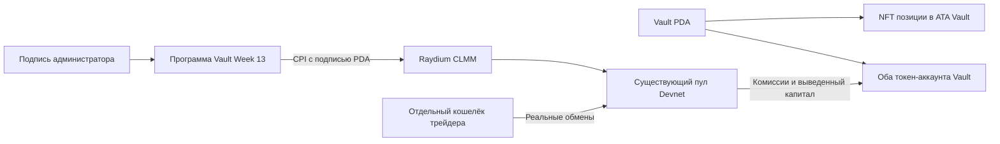

# Liquidity Vault — Неделя 13

**Дополнение о завершении стратегии:** исходные результаты ниже относятся к неизменённому коммиту `87d58a2` и программе `8Fwjh2gQ9qAQFZ4jVPKPe8G6xEq2dQJatFDv4A6iw2Qa`. В разделе [Расчёты после CLMM и вывод средств пользователем](#post-clmm-settlement-and-user-withdrawal) описаны отдельное развёртывание и финализированное погашение долей пользователем. Все исходные доказательства и ссылки сохранены.

**Проверено в Solana Devnet:** открытие позиции под управлением Vault, сбор комиссий, полное закрытие и ребалансировка при выходе цены за диапазон. Независимая проверка успешно выполнена для **25 финализированных транзакций**, включая развёртывание. Все три тестовые позиции закрыты.

## Проверка работы за несколько минут

```bash
npm ci
npm run verify:week13
```

Для проверки не нужны кошелёк, приватный ключ, сборка Anchor или отправка транзакций. Зафиксированный запуск также прошёл с `ANCHOR_WALLET`, указывающим на несуществующий файл. См. [verification-summary.json](evidence/week13/verification-summary.json) и ссылки на транзакции ниже. Проверка выполнена `2026-11-19T17:11:29.505Z` UTC; слоты транзакций определяют историческое исполнение независимо от текущего состояния пула.

## Задание и реализация

[Исходная методология, страница 7](evidence/week13/requirements-page-7.txt), требует выбора границ администратором, внесения обоих токенов с ограничением максимальных сумм, владения NFT позиции со стороны Vault, сбора комиссий, полного вывода с минимальными суммами и фактической ребалансировки при выходе цены за диапазон.

| Инструкция Vault | Официальная последовательность Raydium CPI | Результат |
| --- | --- | --- |
| `open_position` | `open_position_v2` с нулевой ликвидностью, затем `increase_liquidity_v2` | Администратор оплачивает ренту; Vault предоставляет оба токена и владеет NFT |
| `collect_position_fees` | `decrease_liquidity_v2` с нулевой ликвидностью | Комиссии поступают в токен-аккаунты Vault; ликвидность позиции не меняется |
| `close_position` | Полный `decrease_liquidity_v2`, затем `close_position` | Оба токена поступают в Vault, NFT сжигается, аккаунт NFT и персональная позиция закрываются |

Открытие и внесение средств атомарны. Плательщик ренты и владелец полномочий на токены разделены, поскольку Vault PDA — принадлежащий программе аккаунт состояния. Ошибка в любом CPI открытия откатывает всю инструкцию. Вывод ликвидности и закрытие NFT также составляют одну атомарную инструкцию Vault.



Начальные значения для подписи Vault: `["vault", token_mint, bump]`. PDA менеджера использует `["position", vault_state]` и хранит привязанный пул, mint NFT, адрес персональной позиции, диапазон, ликвидность и флаг активности. Одновременно может быть активна только одна позиция. Пары ключей mint NFT подписывают создание аккаунтов; полномочия над токен-аккаунтом NFT принадлежат **Vault PDA**.

## Адреса Devnet

| Аккаунт | Адрес |
| --- | --- |
| Программа Week 13 | `8Fwjh2gQ9qAQFZ4jVPKPe8G6xEq2dQJatFDv4A6iw2Qa` |
| Vault PDA / полномочия над NFT | `CsFJDQv7vdBvXvDzEoSqvZQccFZLbYqAJcTeaSjZUfKN` |
| Аккаунт TOKEN_A | `6ywuuHXGwoXxsMoUufL9BpeLkKGXzohPvrXgxpaLDAyi` |
| Аккаунт TOKEN_B | `DveZCv2hMWqZ5UbdBQxyp4xC6aZPpofpkN2xTzgghHuZ` |
| Mint долей | `GDoh9tMjfVzrUYH7PQxF8KYtfVNkMqay6ELpB8b4e8ET` |
| PDA менеджера позиции | `H4VjkQSzC6fV9NWbf4GyEnyZQ2iFK4hrcrkfbqHJv3Pv` |
| Администратор | `3jiQ6pVz6xZ4VqmDho41aPUgXFQns5KeorWyEgb3Qdq7` |
| Отдельный трейдер | `8YYWcK5FA79Y9L3PMmWaukgEKbHLq9NXFm4TG5Pn1cgJ` |
| Raydium CLMM | `DRayAUgENGQBKVaX8owNhgzkEDyoHTGVEGHVJT1E9pfH` |
| Пул | `EKwcP1HdZsti8ALXNvAUAduWfYLXH76DeJkcH39auM1f` |
| Mint TOKEN_A / token_0 | `7bdCcN9agJ3TSSjTFctxM4TGFVecBRd6gLNYoWYyvawF` |
| Mint TOKEN_B / token_1 | `CwHVUNisByLqXM7mN47nhtcfG8AkYxeJ3tBdFB66yZAt` |

Оба mint относятся к обычным SPL-токенам с **шестью знаками после запятой**. Полный список производных адресов приведён в [addresses.json](evidence/week13/addresses.json). Развёрнута новая программа размером 604,864 байта с выделением памяти точно под её размер; [транзакция развёртывания](https://explorer.solana.com/tx/31oM1gN5Wjzxqd3CaPKpftoLEfXq5xEsEEwPj7NDMrN3SD24W8Cyn9Ypz36vP58NtrepPuCPpMCTYee9uLKJmqZW?cluster=devnet). Верификатор сравнивает развёрнутый ELF с SHA-256 `e6712608e22f254b87a2c48f881ce0502cc6cde62a79bd507d6eae9dd112f666` и проверяет инструкцию развёртывания загрузчика, слот и полномочия обновления.

## Выбранные диапазоны и суммы при открытии

Цена выражается в **TOKEN_B за TOKEN_A**. При одинаковом числе знаков после запятой граница тика равна `1.0001^tick`, а цена исполнения — `sqrt_price_x64^2 / 2^128`. Цены ниже округлены до 12 знаков после запятой; точные значения квадратного корня цены сохранены в сводке проверки. Шаг тиков — 60. Верхняя граница диапазона не включается.

| Позиция | Диапазон тиков | Границы цены | Фактическая цена открытия | Ликвидность | Внесено A | Внесено B |
| --- | --- | --- | --- | --- | --- | --- |
| Обычная | `-720 .. 480` | 0.930534245505 .. 1.049168137486 | 0.989738741819 | `661942349` | 19.119261 | 20.000000 |
| Старая для ребалансировки | `-180 .. -60` | 0.982161916245 .. 0.994018262239 | 0.989689211777 | `5276455704` | 11.562049 | 20.000000 |
| Новая | `-840 .. 360` | 0.919435117457 .. 1.036653980636 | 0.981611022806 | `627135103` | 17.033840 | 20.000000 |

При каждом открытии взносы ограничивались **20.000000 A и 20.000000 B**. Обычный и новый диапазоны простираются на 600 тиков в каждую сторону от выровненного центра, примерно на 6% с каждой стороны. Старая позиция для ребалансировки использует более узкий диапазон общей шириной 120 тиков, чтобы продемонстрировать реальное пересечение границы при умеренных объёмах обмена тестовых токенов.

Состав токенов LP меняется вместе с ценой, поскольку внутри диапазона ликвидность CLMM обменивает один актив на другой. Ниже нижней границы она целиком состоит из token_0, выше верхней — из token_1. При ребалансировке утративший активность диапазон закрывается, а новый открывается вокруг изменившейся цены.

## Обычный жизненный цикл и комиссии

На этапе подготовки внесено **200.000000 A** с выпуском долей. Обмен с подписью Vault конвертировал 100.000000 A в **98.981011 B**. Затем в обычную позицию внесены суммы из таблицы выше. Отдельный трейдер выполнил обмены A→B, B→A и A→B по одному токену каждый. Все три обмена финализированы между открытием и сбором комиссий; подписант, пул и точные перемещения токенов проверяются независимо.

При сборе комиссий изъято **ноль ликвидности**; весь объём ликвидности позиции **661,942,349** сохранён до закрытия. Собственные события Raydium позволяют независимо отделить основной капитал от торговых комиссий:

| Операция сбора | Комиссии A | Комиссии B |
| --- | --- | --- |
| normal-collect | 0.000070 | 0.000035 |
| normal-close | 0.000000 | 0.000000 |
| rebalance-old-close | 0.042706 | 0.000000 |
| rebalance-new-close | 0.000000 | 0.000000 |
| **Итого по позициям Week 13** | **0.042776** | **0.000035** |

При отдельном сборе комиссий обычной позиции получено **0.000070 A и 0.000035 B**. Дополнительные комиссии ребалансировки собраны при закрытии старой позиции; они включены в возвращённую при закрытии сумму и не учитываются повторно как основной капитал. См. [доказательства сбора комиссий](evidence/week13/fee-collection.json) и [проверенные изменения балансов](evidence/week13/balance-deltas.json).

## Закрытие: точные возвращённые суммы

Все суммы указаны точно, с шестью знаками после запятой. Возвращённые суммы включают комиссии, собранные при закрытии; основной капитал указан отдельно. Минимальные суммы применяются к выводу основного капитала из Raydium с дополнительной проверкой фактического изменения балансов Vault.

| Закрытие | Возвращено A | Возвращено B | Основной капитал A | Основной капитал B | Минимум A / B |
| --- | --- | --- | --- | --- | --- |
| [normal-close](https://explorer.solana.com/tx/3LX5jAqgy7aqNSjptmUTcJb3dNvybeBTPgFJi27JqmQp1zDbrQwngcAWQavukBETunAasFmAp8moxNxBTcv8U7fE?cluster=devnet) | 19.135909 | 19.983521 | 19.135909 | 19.983521 | 18.944549 / 19.783685 |
| [rebalance-old-close](https://explorer.solana.com/tx/3EKyy91a98fXnxbFNuGaWhs66nwyDi4Hn9khnbQT4FdHFTrKsHMUygnqj5177YLqDaQBcG26U6V5f4Wa4n6Vt3r9?cluster=devnet) | 31.890409 | 0.000000 | 31.847703 | 0.000000 | 31.529225 / 0.000000 |
| [rebalance-new-close](https://explorer.solana.com/tx/4A2AiSBY9wLRn5U9DLV8ETJbRLEjS9UvUEM4raBLoaWiFhSPEGVBibpAYYC2qBidFJTf8h8kzygpidJkb7mCcd8v?cluster=devnet) | 17.033839 | 19.999999 | 17.033839 | 19.999999 | 16.863500 / 19.799999 |

После окончательного закрытия новой позиции наблюдаемые в транзакции балансы Vault составили **120.345077 A и 78.964566 B**. Оба актива остаются под управлением Vault; вывод в одном токене остаётся заблокированным.

| Позиция | Mint NFT | Аккаунт NFT под управлением Vault | Независимо проверенное итоговое состояние |
| --- | --- | --- | --- |
| normal-open | `BGMmyTvtEzND3uR2ef5FQszHt82xjBhfEfXCytXJGAoy` | `ECbfDWCnxMAZ86j49cYLMwECcN7YXFndcweCo5Yfx7Dr` | Предложение 0; аккаунт NFT и позиция закрыты |
| rebalance-old-open | `EVfhb1eYwmP8YAstSFUTmNMSSvFfzS58H6iSERrWVijd` | `6r3XmRtwcom6E84m18g7eN5SUMNfVBsNQeQU7fqVfK7U` | Предложение 0; аккаунт NFT и позиция закрыты |
| rebalance-new-open | `2wkmWUqhUHXqqsRxHHSYjXstS9DgD2fgi3qM7H5tWpUc` | `DJLMJNQXWMW8vDkD4wtqSvdU9aDRHukf6S9iq9t1sEvg` | Предложение 0; аккаунт NFT и позиция закрыты |

После сжигания обычные SPL mint-аккаунты NFT сохраняются с нулевым предложением. Историческое владение подтверждается финализированными операциями инициализации и выпуска, а также CPI с полномочиями Vault; текущее закрытие верификатор проверяет отдельно. [Доказательства по NFT](evidence/week13/position-nfts.json).

## Подтверждение ребалансировки

Девять реальных обменов по **20.000000 A каждый** вывели цену за пределы старого диапазона `[-180, -60)`. При фактическом исполнении инструкции закрытия старой позиции события Raydium и Vault зафиксировали **тик -186**, цену **0.981611022806**, ниже нижней границы. Старый NFT сожжён. Новая позиция открыта на тике **-186** в диапазоне **[-840, 360)** с новым NFT во владении Vault и положительными взносами обоих токенов. При последующем окончательном закрытии вся ликвидность также выведена, а NFT сожжён.

При закрытии вне диапазона обоснованно возвращено ноль B, поскольку старая ликвидность целиком состояла из A. Минимум для B явно равнялся нулю, а минимум для A был положительным. [Доказательства ребалансировки](evidence/week13/rebalancing.json).

## Безопасность, учёт и ограничения

- Каждая операция управления проверяет подпись администратора, канонические PDA Vault/config/manager, привязку к пулу и идентификатор программы Raydium.
- Проверяются пара mint, полномочия над источником и получателем, mint и держатель NFT, каноническая персональная позиция и адреса массивов тиков. Делегаты NFT и альтернативные полномочия закрытия отклоняются.
- Тики должны быть упорядочены, находиться в допустимых границах и соответствовать шагу. Открытие требует цены внутри диапазона, положительной ограниченной ликвидности и положительных фактических взносов обоих токенов.
- Проверяются максимальные входные и минимальные выходные суммы, целочисленные изменения балансов, сохранённая ликвидность, повторные и недопустимые переходы жизненного цикла. Состояние меняется только после успешных CPI и проверок владения.
- `strategy_active` остаётся true после сбора комиссий и закрытия. `total_tokens` учитывает свободный A, а не стоимость портфеля из двух токенов; предложение долей сохраняется. Восстановление вывода в этой исходной версии не реализовано: для безопасного восстановления необходимо закрыть позиции, обменять B обратно в A и сверить учёт.
- Поддерживается выбранный пул обычных SPL-токенов без начисления вознаграждений. Пока позиции открыты, вознаграждения в нём должны оставаться отключёнными. Универсальная поддержка пулов с вознаграждениями и активов Token-2022 не входит в эту работу.
- [Аудит зависимостей](evidence/week13/dependency-audit.json) сообщает о 19 унаследованных предупреждениях в зависимостях Node (9 умеренной, 10 высокой серьёзности). Совместимые с Anchor/Raydium версии сохранены зафиксированными. Это учебная работа в Devnet; аудит не означает сертификацию для промышленной эксплуатации.
- Независимый верификатор не отправляет транзакции и не читает кошелёк. Стандартный RPC не позволяет получить произвольное историческое содержимое аккаунтов. Сохранённые предварительные чтения и балансы обозначены как наблюдения; исторические изменения подтверждаются метаданными финализированных транзакций, CPI-инструкциями и событиями с проверенным источником.

## Выполненные проверки

| Команда / проверка | Результат | Доказательства |
| --- | --- | --- |
| `cargo fmt --check` | Успешно | [лог](evidence/week13/format.txt) |
| `cargo check --workspace` | Успешно | [лог](evidence/week13/cargo-check.txt) |
| `cargo test --workspace` | Успешно (5) | [лог](evidence/week13/rust-tests.txt) |
| `anchor build` | Успешно | [лог](evidence/week13/anchor-build-recovered.txt) |
| `npm run typecheck` | Успешно | [лог](evidence/week13/typecheck.txt) |
| `npm run test:unit` | Успешно (6) | [лог](evidence/week13/slippage-unit.txt) |
| `npm run test:week13` | Успешно (8) | [лог](evidence/week13/week13-unit.txt) |
| `npm run test:local` | Успешно (17) | [лог](evidence/week13/local-tests.txt) |
| `npm run test:week13:local` | Успешно (11) | [лог](evidence/week13/clmm-local-tests.txt) |
| `Отрицательные RPC-симуляции развёрнутой программы Week 13` | Успешно (44) | [лог](evidence/week13/manifest.json) |
| `npm run verify:week13 (invalid ANCHOR_WALLET)` | Успешно (25) | [лог](evidence/week13/verification.txt) |

**44 отрицательные проверки — это RPC-симуляции развёрнутой программы Devnet**, а не 44 неудачные транзакции в блокчейне. Они охватывают неавторизованные открытие/сбор/закрытие, неверные пул/позицию/тики/владение NFT, максимальные и минимальные суммы, нулевую ликвидность, повторные операции и блокировку вывода. 17 прежних интеграционных тестов и 11 интеграционных тестов с реальными Raydium CPI выполнены на изолированных локальных валидаторах; их результаты отделены от доказательств Devnet.

## Воспроизведение сборки и тестов

Используйте Node 22, Anchor 0.31.1, Solana CLI и Rust; точные версии и хеши исходников приведены в [build-artifact.json](evidence/week13/build-artifact.json).

```bash
npm ci
cargo fmt --check
cargo check --workspace
cargo test --workspace
anchor build
# Восстановление публичного адреса клиентского IDL для этого развёртывания.
cp evidence/week13/program-idl.json target/idl/simple_vault.json
npm run typecheck
npm test
npm run preflight:week13
npm run verify:week13
```

Для прежних локальных тестов загрузите программу этой ветки в отдельный валидатор и задайте `ANCHOR_PROVIDER_URL=http://127.0.0.1:18899` и `ANCHOR_WALLET` перед `npm run test:local`. Тестовая среда CLMM клонирует публичные аккаунты Devnet и ничего не записывает в Devnet:

```bash
node --no-experimental-strip-types -r ts-node/register scripts/week13-local-fixture.ts
mapfile -t CLONE_ACCOUNTS < <(node -e "require('./evidence/week13/local-fixture.json').accounts.forEach(x=>console.log(x))")
solana-test-validator --ledger /tmp/week13-clmm-reproduction --rpc-port 18899 \
  --faucet-port 19900 --dynamic-port-range 19000-19050 \
  --url devnet --mint 3jiQ6pVz6xZ4VqmDho41aPUgXFQns5KeorWyEgb3Qdq7 \
  --bpf-program 8Fwjh2gQ9qAQFZ4jVPKPe8G6xEq2dQJatFDv4A6iw2Qa target/deploy/simple_vault.so \
  --clone-upgradeable-program DRayAUgENGQBKVaX8owNhgzkEDyoHTGVEGHVJT1E9pfH metaqbxxUerdq28cj1RbAWkYQm3ybzjb6a8bt518x1s \
  --clone "${CLONE_ACCOUNTS[@]}"
# Во втором терминале, с исходным кошельком для клонированных токен-аккаунтов:
ANCHOR_PROVIDER_URL=http://127.0.0.1:18899 WEEK13_CLMM_LOCAL=1 npm run test:week13:local
```

Исходная команда развёртывания использовала новую пару ключей Week 13 и явно указанный буфер; оба файла исключены из Git:

```bash
solana program deploy target/deploy/simple_vault.so \
  --program-id target/deploy/simple_vault-keypair.json \
  --buffer target/deploy/week13-buffer-keypair.json \
  --max-len 604864 --url devnet --use-tpu-client --output json
```

Для повторной проверки не нужно повторно развёртывать программу. Новое независимое развёртывание требует новой пары ключей программы, согласованных идентификаторов Anchor/Rust и обновлённых ожидаемых идентификаторов Week 13 в скриптах; зафиксированная программа намеренно защищена от случайного обращения к программам предыдущих недель.

Фактически использованные команды сценария:

```bash
npm run week13:run -- setup
npm run week13:run -- normal
npm run week13:run -- rebalance
npm run week13:run -- cleanup
```

Скрипт сохраняет каждую подписанную сигнатуру **до отправки**, дожидается финализации перед фиксацией успеха и возобновляет работу с учётом завершённых этапов. `npm run week13:run -- recover` обрабатывает ожидающую контрольную точку до повторной попытки. Взносы LP ограничены 20 токенами с каждой стороны; ребалансировка ограничена двенадцатью обменами по 20 A, потребовалось девять. Приватные ключи и кеши по-прежнему исключены из Git.

## Ссылки на финализированные транзакции

Все 24 сигнатуры сценария и транзакция развёртывания ниже независимо получены с уровнем подтверждения finalized. Полные сигнатуры, инструкции и краткие результаты приведены в [manifest.json](evidence/week13/manifest.json) и [verification-summary.json](evidence/week13/verification-summary.json).

| Действие | Слот | Транзакция |
| --- | --- | --- |
| Развёртывание | `523896183` | [развёртывание](https://explorer.solana.com/tx/31oM1gN5Wjzxqd3CaPKpftoLEfXq5xEsEEwPj7NDMrN3SD24W8Cyn9Ypz36vP58NtrepPuCPpMCTYee9uLKJmqZW?cluster=devnet) |
| initialize-vault | `523896854` | [Explorer](https://explorer.solana.com/tx/5ZzZHiiWuuKdFsYXyz6RNxGjqUpjj4HduWhtdSuBqnxXEnZMVvB9gCyGvazxcRrEvTBN1HDAywKUfXAfz86sMJ9w?cluster=devnet) |
| initialize-swap | `523896861` | [Explorer](https://explorer.solana.com/tx/3Wt7hjkTN6LjExthmd8Uo2VooYRRzAHKeWgwEoEcKAB2WfJU8pCyqJZcbGf2przcqh5esFGoLBYJPeMxxDJmn3XD?cluster=devnet) |
| fund-trader | `523896872` | [Explorer](https://explorer.solana.com/tx/3MYqsWrU52zu6ehUDnnpBYwgQRHgtzmxbJbSrybqanEmN5FsUYj4jfZFeAYJzgqRXydzipJKnL6kBA8os1MTCPYS?cluster=devnet) |
| deposit | `523896880` | [Explorer](https://explorer.solana.com/tx/5cS53piuxwzoNp8RK5ZEb4iWiNwtdRy8s6DsC1wFmAuBqSSyfGWCyZoY5BQtbiYGq4t1vL8NMe2mLsbZjnqegN2j?cluster=devnet) |
| prepare-vault-token-b | `523896901` | [Explorer](https://explorer.solana.com/tx/51QEF3rJHMEKP76R1PYJoX6QSLchDGTEYPtRherzVZjPZWMNheC7RDJNVjH8JfSd49CABsVXq8ZEf4gE4PSMoMmv?cluster=devnet) |
| normal-open | `523897041` | [Explorer](https://explorer.solana.com/tx/5EKaaMGb8WZQP9X39qzSU4zxXXHpGkSUHh7wMRCaSb2gbWAuBd4unxZ5tjv4f192gmRNgjxqh7MrTcnGQZXqT6cV?cluster=devnet) |
| normal-swap-1 | `523897078` | [Explorer](https://explorer.solana.com/tx/4iw3QkQ9fQ9LLuwPpCr7FCyNJuFcp2wyq2PLFvGkfDzmJ3xq5Te7L59zNv8uHP2Asvw6LApoGKUUcjR9bD1rZxYt?cluster=devnet) |
| normal-swap-2 | `523897092` | [Explorer](https://explorer.solana.com/tx/5bimyKi4TkFFYaLPnjmtuRBGwy6ZoLsqeQc6a7gnmv9qSVfmgu3QgGhi52pVbMbpKWipDRbiSagQCvtArNtDpYDv?cluster=devnet) |
| normal-swap-3 | `523897110` | [Explorer](https://explorer.solana.com/tx/4XZAcYrGooJexfGkLRsVRQHkCtN1a1UpQBNN5ggF6S1Tgo5QNzM742vyRAve1US8kdrQjAGL454cFYHYWCWjHbHU?cluster=devnet) |
| normal-collect | `523897122` | [Explorer](https://explorer.solana.com/tx/5PMwYAdNNzFj8KNjbDcLoxjsk6QpifT3Y5MJC4tEya4baqhnSaQbQrtpppU24xjq4CY9p96s3ggR2vAec8fHfnbK?cluster=devnet) |
| normal-close | `523897144` | [Explorer](https://explorer.solana.com/tx/3LX5jAqgy7aqNSjptmUTcJb3dNvybeBTPgFJi27JqmQp1zDbrQwngcAWQavukBETunAasFmAp8moxNxBTcv8U7fE?cluster=devnet) |
| rebalance-old-open | `523897287` | [Explorer](https://explorer.solana.com/tx/4T6QHDWSKyuRBaUenXeMWXhr36E3cN6NZ7JYbqep2diNhkUi77UhRqYisf42SXXVhrwaQtxFg5bonViKeMDnp6rN?cluster=devnet) |
| rebalance-move-0 | `523897324` | [Explorer](https://explorer.solana.com/tx/328XJc5ZtAJPLzeFpBZ5nBkRVBftzZ1diRvbMHfkH27AvivPTFmoEwDqdVmLKaSo7eS6cETDgqLiJokiKs8TUMLz?cluster=devnet) |
| rebalance-move-1 | `523897338` | [Explorer](https://explorer.solana.com/tx/55PBkx2EnGjD4wRTXe1jUeMm216pRKVzVsrGkDFnbfoGS49LtqSUvQeDGeoT51qmF4mz6VKMXKN93BS5BbK8Jchp?cluster=devnet) |
| rebalance-move-2 | `523897356` | [Explorer](https://explorer.solana.com/tx/3nq3hkNGzmcmFEg2xDHYthbfmsnkwXJQaBLqXNK2JgP9ECwL5iNHmNacncJxRRJabBYCaMwXLKEhaNk6bzTjTXf7?cluster=devnet) |
| rebalance-move-3 | `523897373` | [Explorer](https://explorer.solana.com/tx/2QxQWVK83Zg3t78JpRJMjYzTAKeS9oKK5FBeV4LTBC3vPEqe6jY3c81LxLLzHSnCJqp3PsGr9B7HrS744uoAxzCe?cluster=devnet) |
| rebalance-move-4 | `523897394` | [Explorer](https://explorer.solana.com/tx/3a341aUke4jtrLGH9wG5GQfXFdPJdUT7TsY3mRPSxzRRHJoC2zTE7RrHQAppkaF7E1sVas3pi8BH4YCShR51YNj?cluster=devnet) |
| rebalance-move-5 | `523897414` | [Explorer](https://explorer.solana.com/tx/4kn63cSKWb3YsEiZKwnnBP16wXbyLvhCckEwUFMh8CJi6jfihNcJr93wqBDudVxMsWGzFnB2KbjxC76eNbSWYpYa?cluster=devnet) |
| rebalance-move-6 | `523897438` | [Explorer](https://explorer.solana.com/tx/5FMG3h2Ag3s1YL59tcLMZwMCryoyJuvE2iTGMAwokVRn8LecpbYfrbRmfWNoHrUgmrHheMj13xSXYnUXzxCJFvKY?cluster=devnet) |
| rebalance-move-7 | `523897457` | [Explorer](https://explorer.solana.com/tx/J5WMzdz5svwvCfgWrmzuxC5yy6WsCFCzEVskxEAGuwRWWqCqh9J13LK3CcuPMtfhTTMdqkW7yBjY7zP1M2CJFmf?cluster=devnet) |
| rebalance-move-8 | `523897479` | [Explorer](https://explorer.solana.com/tx/25xWVBnVzPRLWkhbW2BETEEGktSZ6uNi1ppCkQwbfLmtZgzsR1MJQ317CAy21SphDJj6NHxbiTvZAdqd2b8WgmM6?cluster=devnet) |
| rebalance-old-close | `523897500` | [Explorer](https://explorer.solana.com/tx/3EKyy91a98fXnxbFNuGaWhs66nwyDi4Hn9khnbQT4FdHFTrKsHMUygnqj5177YLqDaQBcG26U6V5f4Wa4n6Vt3r9?cluster=devnet) |
| rebalance-new-open | `523897531` | [Explorer](https://explorer.solana.com/tx/63rFT7FahY3eJgTJsRZZgqJ5ZZRf3Tu9gRE6cewAunjTw259vRxBzJxpAAVskq2FJBvFJHnQLodYKc3S2Da3vgEP?cluster=devnet) |
| rebalance-new-close | `523897643` | [Explorer](https://explorer.solana.com/tx/4A2AiSBY9wLRn5U9DLV8ETJbRLEjS9UvUEM4raBLoaWiFhSPEGVBibpAYYC2qBidFJTf8h8kzygpidJkb7mCcd8v?cluster=devnet) |

## Соответствие требованиям и доказательства

| Требование методологии | Проверенные доказательства |
| --- | --- |
| Администратор выбирает границы; оба токена вносятся с ограничением максимальных сумм | Три транзакции открытия; точная таблица диапазонов/взносов; симуляции отклонения превышенных максимумов |
| Vault управляет NFT | Финализированные SPL-инициализация/выпуск; CPI увеличения/уменьшения с подписью Vault; доказательства владения NFT |
| Сбор торговых комиссий | Обычный сбор, события комиссий Raydium и точные проверенные изменения балансов |
| Вывод всей ликвидности с минимумами; закрытие NFT | Три закрытия; совпадение всей ликвидности; инструкции сжигания/закрытия и текущие проверки нулевого предложения |
| Операции только администратора | Симуляции неавторизованных открытия, сбора и закрытия; локальные CPI-тесты |
| Официальный совместимый Raydium CPI | Зафиксированный интерфейс и реальные дискриминаторы/привязки аккаунтов вложенных CPI |
| Открытие ? обмены другого кошелька ? сбор ? закрытие | Обычный сценарий с тремя подписанными обменами трейдера и упорядоченными финализированными слотами |
| Выход цены за диапазон ? закрытие ? повторное открытие | Девять обменов; фактический тик закрытия -186 вне [-180,-60); новая позиция [-840,360) |
| Документирование диапазонов, комиссий и точных возвращённых сумм | Таблицы выше; независимые события и доказательства изменений балансов |
| Безопасный учёт вывода | Сохранение блокировки стратегии; тесты учёта долей; отсутствие небезопасного восстановления |
| Независимая проверка без кошелька | Успешная проверка публичным RPC с неверным путём кошелька; проверки ELF/хеша/полномочий/транзакций |
| Сохранение предыдущих недель | Изолированные ветка/каталог и новый ID программы; исходный README в [README-WEEK12.md](README-WEEK12.md); аудит изоляции |

## Изоляция и официальные источники

Публичный [Anchor IDL](evidence/week13/program-idl.json) включён для клиентов и локального воспроизведения. Новая команда `anchor build` может создать другую локальную пару ключей и другой адрес в IDL; восстановление этого публичного IDL сохраняет зафиксированный адрес без распространения ключа подписи. Независимый верификатор не использует этот IDL. См. [итоговый аудит безопасности и изоляции](evidence/week13/security-audit.json).

Работа начата от коммита `b3446244d017cd807dfc280eb0b8c4defd4729d7` ветки `origin/week-12-submission` в ветке `week-13-submission`. Прежние ветки, программы и исторические доказательства сохранены. Требуемые обмены намеренно изменяют цену общего тестового пула. Все новые доказательства находятся в `evidence/week13/`.

- [Официальные примеры Raydium CPI](https://github.com/raydium-io/raydium-cpi-example/tree/master/clmm-cpi/programs/clmm-cpi/src/instructions).
- [Зафиксированный публичный интерфейс программы](https://github.com/raydium-io/raydium-clmm/blob/d4ec101534724a20e1eb38a9b997f8b391c5100f/programs/amm/src/lib.rs), ревизия `d4ec101534724a20e1eb38a9b997f8b391c5100f`.
- [Зафиксированная реализация открытия позиции](https://github.com/raydium-io/raydium-clmm/blob/d4ec101534724a20e1eb38a9b997f8b391c5100f/programs/amm/src/instructions/open_position.rs).
- [Зафиксированная реализация уменьшения ликвидности и сбора комиссий](https://github.com/raydium-io/raydium-clmm/blob/d4ec101534724a20e1eb38a9b997f8b391c5100f/programs/amm/src/instructions/decrease_liquidity.rs).

Порядок аргументов публичного CPI взят из зафиксированного `lib.rs` и отличается от порядка во внутренней вспомогательной функции. Операции SDK с ликвидностью от имени кошелька не используются как доказательство функциональности Vault CPI.

<a id="post-clmm-settlement-and-user-withdrawal"></a>

## Расчёты после CLMM и вывод средств пользователем

### Учёт и изоляция развёртывания

Исходная программа во время выполнения стратегии учитывает свободный TOKEN_A в `total_tokens`. Эта сумма не может использоваться для оценки долей, пока остаются TOKEN_B или активы LP. Поэтому закрытие позиции сохраняет `strategy_active` равным true. Исходный прямой обмен закрепляет A как вход, а B как выход и не предоставляет обратного пути. В [аудите учёта](evidence/week13/settlement/accounting-audit.md) зафиксированы эти выводы, а также исходные пробелы при выпуске долей с нулевыми активами и учёте вне активной стратегии.

Новая реализация развёрнута отдельно по адресу **`Cm1i9GJUXXvZPA1cDeZ62FjCsmz8w8LJXe91drJYWYx9`**, Vault — **`6YafwX7ujgJUrP1hQPeGRQCB2ZxbzcgWRphJjvgj92gD`**. Исходное развёртывание Week 13 и его заблокированный Vault не изменены, а 25 транзакций по-прежнему проверяются независимо. Ветки и развёртывания Weeks 8–12 сохранены. `Anchor.toml` сохраняет исходный идентификатор; Cargo-функция `settlement-deployment` выбирает изолированный идентификатор. Скрипт развёртывания проверяет genesis Devnet, точный хеш артефакта, личность подписанта и наличие средств и отказывается обновлять существующую программу. Для воспроизведения этого дополнения не используйте `anchor deploy`.

### Состояния и переходы при завершении стратегии

1. Пользователи вносят A и получают SPL-доли. Внесение и вывод отклоняются при активной стратегии, остатке B, несовпадении предложения долей или устаревшем учёте A. Добавленный канонический клиентский аккаунт `strategy_token_account` обязателен для обеих инструкций в новом IDL.
2. Администратор открывает и управляет существующей позицией Raydium под контролем Vault. Закрытие удаляет всю учитываемую ликвидность, сжигает NFT и закрывает его токен-аккаунт и персональную позицию; стратегия остаётся заблокированной.
3. `reverse_swap_via_raydium(amount_in, minimum_amount_out)` доступна только администратору и требует неактивной позиции с нулевой ликвидностью. Она меняет направление аккаунтов существующего CPI `swap_v2`. Входная сумма должна равняться всему каноническому балансу B, а минимум должен быть положительным. Проверенные фактические изменения должны подтвердить списание точной входной суммы, получение не менее минимального A и нулевой остаток B. Ошибка атомарно откатывает операцию; успех сохраняет блокировку.
4. `settle_strategy` проверяет канонические Vault/config/pool/mint/токен-аккаунты, администратора, нулевую ликвидность, неактивный менеджер, mint сожжённого NFT без полномочий выпуска, а также закрытие канонических аккаунтов NFT и персональной позиции. B должен равняться нулю, количество непогашенных долей должно быть положительным, а предложение SPL — совпадать с учтёнными долями. Инструкция записывает фактический A в `total_tokens`, сохраняет все доли и снимает блокировку. Повтор без изменения состояния возвращает `AlreadySettled`.
5. Пользователь подписывает `withdraw(shares)` и получает `floor(shares * total_tokens / total_shares)` минимальных единиц A с использованием проверяемой целочисленной арифметики. Эта же транзакция сжигает доли и обновляет оба итога. UserCard хранит историю; владение определяется SPL-балансами и предложением. Последний держатель получает весь оставшийся A.

Прямые переводы A вне активной стратегии требуют явной сверки администратором. Прямые переводы B блокируют погашение даже после разблокировки; администратор может полностью обменять этот B обратно и снова завершить расчёты. При несовпадении предложения долей операции блокируются. Если минимальный остаток B нельзя обменять с положительным минимумом, Vault остаётся заблокированным. Завершение расчётов не выполняет переводов, выпуска или сжигания долей.

### Финализированные результаты Devnet

Все 15 успешных транзакций сценария и новое развёртывание перечислены ниже. Пользователь `98SVWHgDL6rWLJBEE4zozMUGBpukcnULhmq4aqAZ4w2H` отличается от администратора и трейдера, создающего комиссии. Публичные [манифест](evidence/week13/settlement/manifest.json), [снимки балансов и долей](evidence/week13/settlement/balance-and-share-snapshots.json), [отрицательные результаты](evidence/week13/settlement/negative-test-results.json), [публичный IDL](evidence/week13/settlement/program-idl.json) и [сводка независимой проверки](evidence/week13/settlement/verification-summary.json) содержат точные значения в минимальных единицах.

| Контрольная точка | A в Vault, минимальные единицы | B в Vault, минимальные единицы | Предложение долей, минимальные единицы | Стратегия заблокирована |
| --- | ---: | ---: | ---: | --- |
| deposit | 200000000 | 0 | 200000000 | false |
| normal-close | 100016745 | 97649294 | 200000000 | true |
| reverse-all-b | 199506361 | 0 | 200000000 | true |
| settle-strategy | 199506361 | 0 | 200000000 | false |
| user-withdraw | 0 | 0 | 0 | false |

Пользователь внёс **200.000000 A** и получил **200,000,000 минимальных единиц долей**. После закрытия осталось 100,016,745 минимальных единиц A и 97,649,294 минимальных единиц B. Полная конвертация B вернула 99,489,616 минимальных единиц A при минимуме 98,494,719. При завершении расчётов сверено 199,506,361 минимальных единиц A с неизменными 200,000,000 минимальных единиц долей. Погашение всех долей вернуло **199.506361 A** (шесть знаков после запятой). Тест учитывает комиссии, движение цены, торговые комиссии и проскальзывание; он не подтверждает прибыль или гарантированный курс. Итоговые балансы A и B в Vault, учтённые итоги, пользовательский баланс долей и предложение SPL-долей равны нулю; активной учитываемой LP нет.

| Действие | Финализированный слот | Explorer |
| --- | ---: | --- |
| settlement-deployment | 524343232 | [транзакция](https://explorer.solana.com/tx/XD1vSBiLE94esqjaLxEEw8r9wGT3krRtQa6LaxPxWNPPsPA5jiWjejj6XRR6TiUMi7GVDzvxeB9abHmqB58HWv8?cluster=devnet) |
| initialize-vault | 524345494 | [транзакция](https://explorer.solana.com/tx/3HMe3E9isJ2KjPxT9x4VmrtXNCbWEfaeJjMNAu6fEXM5zi9P5Y2mz2NkdzX6ANK6MkCdZLisusCNUeQYKc9zDWpa?cluster=devnet) |
| initialize-swap | 524345504 | [транзакция](https://explorer.solana.com/tx/3jzF1ghdxvqcQWadpLB8KcDqZgfRwfaZCvdMkCKt4yQfkbzkWR1YppamaTGoZSc3QAHb6cbW13okQuNN3ngzQqGZ?cluster=devnet) |
| fund-trader | 524345515 | [транзакция](https://explorer.solana.com/tx/4wB978qbNCmUg2TZ4FUp4KZVHZfj1QH34j712obcB7pDXoxsEetu4b7JMjAyzeNaF7NSAgHRhfsmCoaNK1CotSty?cluster=devnet) |
| fund-user | 524345524 | [транзакция](https://explorer.solana.com/tx/42iCveVce4jqoSaFGDuCyvQxNCdJ6eWWEWkvsNEiRdKcu9h25QXWUpiR4XPrzafKN7Dvdx2hSfD7R7meNZ7M6jSt?cluster=devnet) |
| deposit | 524345534 | [транзакция](https://explorer.solana.com/tx/43rdydZWa5UxgGVR5UAxS98Gd6gwwmVvD3VyFRnfcu7aSLXjU9RfAz88WJid19Qc7CmJ3hmxxB9uN3xR4hUtcbKd?cluster=devnet) |
| prepare-vault-token-b | 524345547 | [транзакция](https://explorer.solana.com/tx/cGBC6VUzZDmdkBjEmUgbRHEtaZV8KtguWjWnzeTzYTUV1qQYYbjWjdeXacCvZvjf4ni62na187ENN467yhx3MeR?cluster=devnet) |
| normal-open | 524346047 | [транзакция](https://explorer.solana.com/tx/2agtZPSEuymGtbskrTmi9KuEi97U8MwUXnpjkQvKfaK1HWs6jVum1iyUXMrj4bPFwXBsGixRSBxeKmPiPX7tgBYL?cluster=devnet) |
| normal-swap-1 | 524346074 | [транзакция](https://explorer.solana.com/tx/4d19viMD8s82cbZRtsskeMPoPW6T7s2ZtfzCJRMfkfiC5txoB5QNGT1JbNkVxUpg86ki6DBb8FWNBNAKnRad9GB7?cluster=devnet) |
| normal-swap-2 | 524346087 | [транзакция](https://explorer.solana.com/tx/4Pu15jVqKSvRbFXBE86u6pT5URhCijW6N8ukpdbHco8vZyRPw37nYfddnPukKDwFxomjZkktyF4Dahxvgvcv4cpD?cluster=devnet) |
| normal-swap-3 | 524346108 | [транзакция](https://explorer.solana.com/tx/5uprc62qgcWqjbzXUXT98ofzezLjQnrzxpBx5S5mJ7YiJUtmBS4SFAC62xM5UWA7ar9BkPpvmnYtXoDPZCKRCWWn?cluster=devnet) |
| normal-collect | 524346120 | [транзакция](https://explorer.solana.com/tx/2bHY9czX1sWgArAZNffKC6f191yB42TrEEPapX5H5r59FmR1axNgWqdtkQKcgxYdZVurQTgTcqfyVcDtMWVReFcR?cluster=devnet) |
| normal-close | 524346139 | [транзакция](https://explorer.solana.com/tx/2HTpH3wufCRfLfJZf9SUu5H8He2DDz1adcbUiu3NagrQuQ6JJRXpxVe5N23s7WMp75K6SEh5vB1kZthKMVbYWAYD?cluster=devnet) |
| reverse-all-b | 524346461 | [транзакция](https://explorer.solana.com/tx/3LEsdAgF3K3i9FuTVPoLDpUwBNRxo9Bs8J8cPyMCeEPQgAnYopbg9vQHmNFRWS6MNbB4VUAV5kqRX2t4hAGEAgta?cluster=devnet) |
| settle-strategy | 524346471 | [транзакция](https://explorer.solana.com/tx/2qjqX14uHSrjDCdRY7zfmRSuDwrVxccNepLQCpizPWLGLo15165SsbvdTaiBa6xXLgqGRmSeQu2URvsw6XbfqJoX?cluster=devnet) |
| user-withdraw | 524346684 | [транзакция](https://explorer.solana.com/tx/4sf9KKiUdA7nKtkESYzymfMRiyWX9wUDuKxiM3d2Gxzwe8YR76ptasrJWtxwEvpm8KJrTQYcrr7Sz5dc8zdiuYWc?cluster=devnet) |

Две намеренно неудачные транзакции также финализированы; каждая завершилась требуемой ошибкой без изменения балансов токенов и долей:

- [withdraw-while-active](https://explorer.solana.com/tx/4XMXuL5TcNstk2WLXZZ1ZWc1Lb4qZd2EbxRQoCfeti4Mt2LDHK8xDzXPkGm7hDmstRyWcChq81wRVGebz5WSZBBr?cluster=devnet): `StrategyActive`.
- [reverse-slippage-failure](https://explorer.solana.com/tx/2bfdW9KDeZxwLuWUedGmyhCFVbKjyRq4B71JPsE2V4o49hguLy1uEvjqjsroBQjAQt9g2y3FyQmDJRnUg8fA5gu?cluster=devnet): `TooLittleOutputReceived`.

### Тесты и воспроизведение

Свежие результаты приведены в [test-results.json](evidence/week13/settlement/test-results.json): пройдено 8 Rust-тестов; существующие наборы TypeScript — 6 проверок проскальзывания и 8 проверок целостности верификатора; 7 проверок арифметики расчётов; на локальном валидаторе — 17 прежних тестов и 11 тестов реальных Raydium CPI. Локальный сценарий завершения стратегии выполнил 15 успешных транзакций, 34 симуляции с конкретной ожидаемой ошибкой и две ожидаемо неудачные транзакции; он обозначен как **LOCAL** и отделён от реальных доказательств Devnet. Реальный запуск Devnet также содержит 34 симуляции с конкретной ожидаемой ошибкой и две финализированные неудачные транзакции. [Результаты отрицательных тестов](evidence/week13/settlement/negative-test-results.json) указывают каждую ожидаемую ошибку и соответствующие логи, включая расчёты при активной позиции, остаток B, неавторизованного подписанта, неверные пул/mint/PDA/аккаунт, недопустимую сумму, частичную конвертацию, проскальзывание, преждевременный вывод, повторные расчёты, превышение числа долей, неверный аккаунт долей, округление, устаревший учёт активов и несовпадение предложения.

При установленных Rust, Solana/Agave, Anchor 0.31.1, Node 22 и неизменённых lock-файлах зависимостей:

```bash
npm ci
cargo fmt --check
cargo check --workspace
cargo test --workspace
anchor build
npm run typecheck
npm test
npm run test:settlement
# Сборка исходного и изолированного вариантов; без отправки транзакций:
npm run build:settlement
# Клонирование публичных аккаунтов Devnet в изолированный локальный валидатор; старые и новые тесты:
npm run test:settlement:local
# Только публичный RPC, без кошелька и сборки:
ANCHOR_WALLET=/nonexistent/no-wallet.json npm run verify:week13
ANCHOR_WALLET=/nonexistent/no-wallet.json npm run verify:week13:settlement
```

Новый верификатор делает паузы между чтениями публичного RPC. При ограничении частоты RPC может потребоваться повтор; неизменённый исторический верификатор запущен с временной обёрткой, добавляющей паузу 1.8 секунды между запросами, что зафиксировано в его свежей [сводке проверки](evidence/week13/settlement/historical-verification-summary.json). Все исходные проверки сохранены. Оба верификатора отклоняют изменённый развёрнутый ELF или слот обновления. Верификатор завершения стратегии независимо получает метаданные финализированных транзакций, выпуск/сжигание долей и переводы, Raydium CPI с подписью Vault, закрытие LP/NFT, полную конвертацию B, событие завершения расчётов, полученные пользователем средства и текущие нулевые балансы/предложение. Сохранённые снимки — наблюдения, а не архивные доказательства содержимого аккаунтов.

Локальные тесты клонированной среды используют настроенный тестовый ключ администратора, соответствующий `sourceAdmin` в публичной конфигурации; ключи подписи не распространяются. Публичная проверка не требует ключа подписи. Существующий запуск Devnet завершён и должен проверяться только чтением. Подписанные этапы сценария выполнялись в порядке `npm run week13:settlement -- setup`, `-- normal`, `-- settle`, `-- withdraw`. Они требуют авторизованного администратора и исключённых из Git локальных ключей пользователя/трейдера; сигнатуры сохраняются до отправки. `-- recover` проверяет ожидающую отправку перед повтором. Новая публичная демонстрация требует отдельно спланированных идентификатора/Vault и собственного манифеста; скрипт развёртывания отказывается повторно использовать существующую программу. Воспроизведение сборки и локальных тестов записывает временные результаты в исключённый из Git каталог `.tools/`; режимы записи доказательств отказываются перезаписывать доказательства развёртывания.

### Сводное соответствие методологии

| Требование | Доказательства |
| --- | --- |
| Диапазон выбирает администратор; максимумы обоих токенов; реальный Raydium CPI | Исходные доказательства по 25 транзакциям выше; новый `normal-open`, локальные регрессионные CPI-тесты |
| NFT и ликвидность под контролем Vault; комиссии; полное закрытие с минимумами | Исходные обычный сценарий и ребалансировка; новые проверки CPI открытия/сбора/закрытия и NFT |
| Обмены отдельного кошелька для создания комиссий | Три новых обмена с подписью трейдера между открытием и сбором |
| Закрытие вне диапазона и повторное открытие | Сохранённые исходные доказательства ребалансировки; неизменённый `position.rs` и пройденные регрессионные тесты |
| Внесённый A и корректный выпуск долей | Новый `deposit` с подписью пользователя; разобранный SPL-выпуск с полномочиями Vault и изменения балансов |
| Блокировка при активной LP и до завершения расчётов | Финализированная ошибка `withdraw-while-active`; явные отрицательные тесты стратегии/активной позиции/остатка B |
| Закрытие до полной конвертации B; положительный минимум с учётом проскальзывания | Последовательно `normal-close`, затем `reverse-all-b`; точные привязки Raydium CPI и изменения балансов |
| Сверка фактического A без изменения долей; авторизованная разблокировка | Событие `settle-strategy`, неизменное предложение, отсутствие выпуска/сжигания/переводов; проверки аккаунтов/NFT и отрицательные тесты |
| Корректное погашение пользователем и сжигание долей | Финализированный `user-withdraw`, целочисленное округление вниз, точное увеличение A пользователя и SPL-сжигание |
| Отсутствие оставшихся учитываемых LP, B, A и долей пользователя | Текущие RPC-проверки верификатора завершения стратегии и итоговые снимки |
| Проверка только чтением, сборки, тесты безопасности, сохранение прежних недель | Логи обоих верификаторов, свежих тестов и итоговый аудит в каталоге доказательств завершения стратегии |

Итоговый [аудит](evidence/week13/settlement/final-audit.json) фиксирует сохранность исторических хешей, проверки прежних веток/развёртываний и точный [список изменённых файлов](evidence/week13/settlement/changed-files.json). Зависимости не менялись ради устранения исходных 19 предупреждений аудита (9 умеренной, 10 высокой серьёзности). Область работы — тестовые активы SPL Token и учитываемый пул без вознаграждений; Token-2022/пулы с вознаграждениями и внешняя сертификация экономической безопасности не входят в эту демонстрацию.
